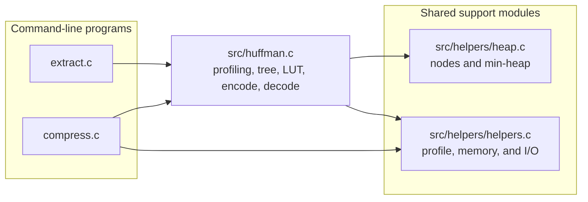

# Huffman Compression

A learning project that compresses and extracts files using Huffman coding in C. The implementation treats input as bytes, counts the frequency of each possible byte value, builds a Huffman tree, and encodes the input using the resulting codes.

## Build

Build both programs with `make`:

```sh
make
```

The Makefile uses GCC in C17 mode and enables AddressSanitizer in its debug build. The implementation uses POSIX file-descriptor operations such as `open`, `read`, `write`, and `lseek`.

## Usage

```sh
./bin/compress INPUT OUTPUT
./bin/extract ARCHIVE OUTPUT
```

Each program takes an input path and an output path. Compression scans the input to collect frequencies, then seeks back to read it again and encode it. As a result, the compressor requires a seekable input file.

## Program Connections



The Makefile links the shared source modules into both executables. Headers declare the shared API and data structures. See [the architecture guide](docs/architecture.md) for what each module and function does.

## Implementation

- The profiler counts all 256 possible byte values in a fixed-size profile. It reads input in chunks of `BUFFER_SIZE`, which defaults to 4096 bytes.
- Zero-frequency entries are removed and the remaining entries are ordered by frequency. The profile's node array is then used as a min-heap; each step combines the two least-frequent nodes into a parent.
- The Huffman tree is pointer-linked: each internal node stores left and right child pointers. A traversal builds a 256-entry lookup table (LUT) so encoding can find a byte's code without searching the tree for every input byte.
- The compressor writes the original byte count and symbol frequencies before the encoded data. It packs encoded bits into bytes and writes through a fixed-size output buffer rather than creating intermediate files.
- The extractor reads the frequency table, rebuilds the same tree, and decodes the remaining data until it has produced the recorded original byte count. This count also means final-byte padding does not become extra decoded output.
- A one-symbol input is assigned a one-bit code by the current implementation.

## Archive Layout

| Field | Size | Description |
| --- | ---: | --- |
| Original size | 8 bytes | Original input length as an `int64_t` |
| Symbol count | 2 bytes | Number of distinct byte values as a `uint16_t` |
| Symbol entries | 9 bytes each | One byte value followed by its frequency as an `int64_t` |
| Encoded data | Remaining bytes | Huffman code bits packed into bytes |

The integer fields are written from their native in-memory representations, so their byte order depends on the host. The archive currently has no magic value, version field, or checksum.

## Current Limitations

- Empty input is not handled as a valid archive by the current tree-building and LUT path.
- The extractor checks that the symbol count is at most 256 and that the listed frequencies sum to the recorded original size, but the archive format does not include a checksum.
- Output files are opened without truncation. If an output path already exists and the new result is shorter, trailing bytes from the old file can remain.
- The extractor currently prints decoded symbols and completion messages to standard output.

## Future Work

- Make the compression function more modular by breaking some of its work into smaller functions.
- Enable directory compression and decompression.

## Topics To Explain

### Masking

### Bit Packing

### LSB vs MSB

### Lookup Table (LUT)

### Tradeoffs